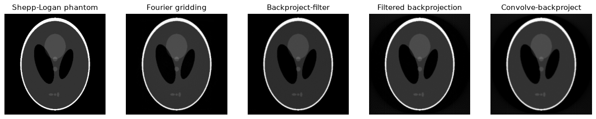
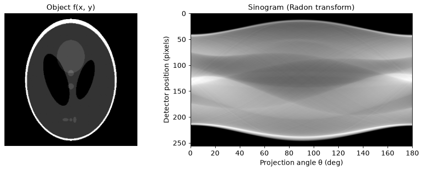
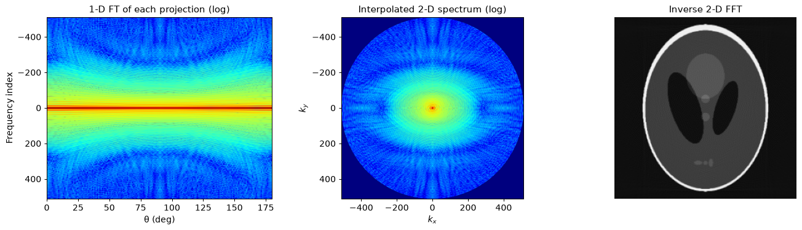
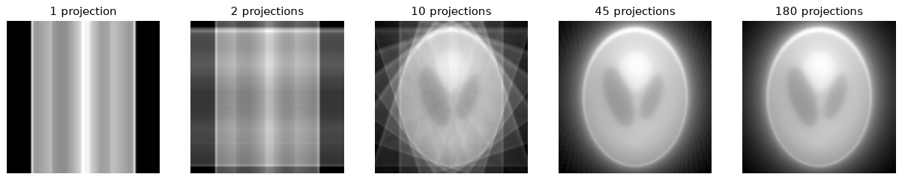
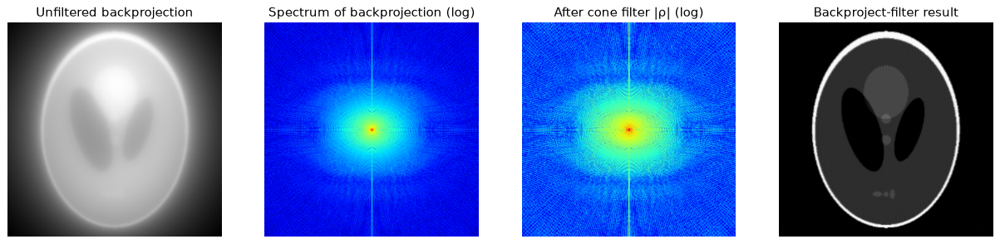
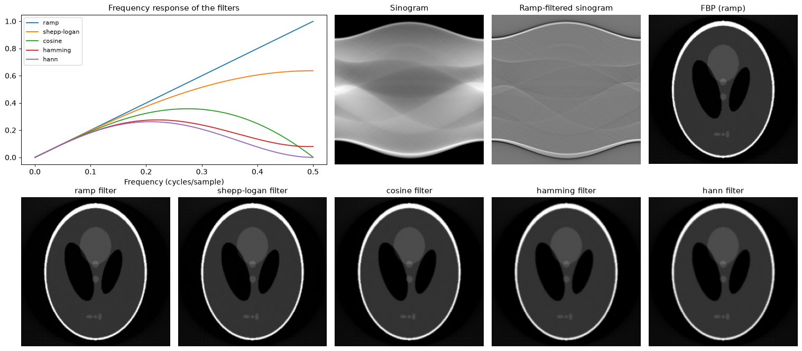
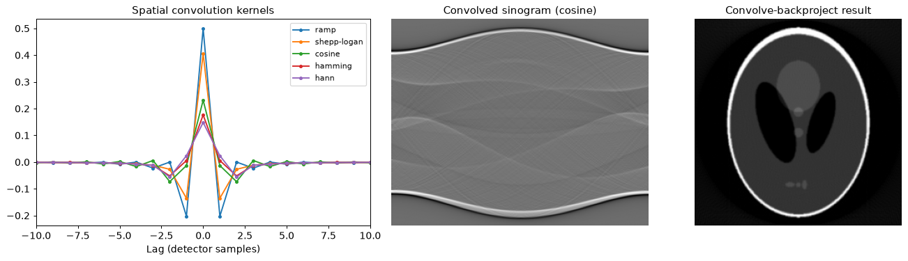

# Analytical Tomographic Image Reconstruction

Welcome to the Analytical Tomographic Image Reconstruction repository! This collection of Python code provides implementations for various analytical tomographic image reconstruction algorithms. These algorithms play a crucial role in transforming projection data into detailed images, making them valuable tools in medical imaging, materials science, and more. Included are **Fourier Gridding**, **Backproject Filter**, **Filtered Backprojection** and **Convolve Backproject**.



## Installation

```bash
pip install git+https://github.com/GivralNguyen/Python-Medical-Analytical-Tomographic-Image-Reconstruction.git
```

Or from a local clone (editable, with the extras for the notebook and tests):

```bash
git clone https://github.com/GivralNguyen/Python-Medical-Analytical-Tomographic-Image-Reconstruction.git
cd Python-Medical-Analytical-Tomographic-Image-Reconstruction
pip install -e ".[notebook,test]"
```

Requires Python ≥ 3.9; dependencies (numpy, scipy, scikit-image, imageio) are installed automatically.

## Quick Start

```python
import numpy as np
import tomorecon as tr

phantom = tr.shepp_logan()             # 256 x 256, bundled with the package
theta = np.arange(180)                 # projection angles in degrees
sinogram = tr.radon(phantom, theta)    # shape (256, 180): one projection per column

image = tr.fbp(sinogram, theta)                         # filtered backprojection
image = tr.fbp(sinogram, theta, filter="hann")          # 'ramp', 'shepp-logan', 'cosine', 'hamming', 'hann'
image = tr.cbp(sinogram, theta)                         # convolve-backproject (spatial-domain filtering)
image = tr.bpf(sinogram, theta)                         # backproject-filter (2-D cone filter)
image = tr.fourier_gridding(sinogram, theta)            # direct Fourier reconstruction
image = tr.backproject(sinogram, theta)                 # unfiltered backprojection (blurred)
```

Every step is also available on its own, e.g. `tr.filter_sinogram`, `tr.convolve_sinogram`, `tr.spatial_kernel`, `tr.cone_filter`, `tr.projection_spectra`, `tr.polar_to_cartesian` and `tr.inverse_fft2`. See the [tutorial](https://github.com/GivralNguyen/Python-Medical-Analytical-Tomographic-Image-Reconstruction/blob/main/tutorial.ipynb) for how they fit together.

### API

| Function | Description |
|---|---|
| `shepp_logan(size=256)`, `disk(...)`, `load_image(path, size=256)` | Test objects |
| `radon(image, theta=None, circle=True)` | Sinogram, shape `(n_detectors, n_angles)` |
| `backproject(sinogram, theta=None, output_size=None, interval=1)` | Unfiltered backprojection |
| `fbp(sinogram, theta=None, filter="ramp", output_size=None)` | Filtered backprojection |
| `cbp(sinogram, theta=None, filter="ramp", output_size=None)` | Convolve-backproject |
| `bpf(sinogram, theta=None, filter="ramp", output_size=None, grid_factor=2)` | Backproject-filter |
| `fourier_gridding(sinogram, theta=None, output_size=None, oversample=4)` | Direct Fourier reconstruction |

Angles are in degrees; if `theta` is omitted, the projections are assumed equally spaced over [0°, 180°).

## Sample Results

All images below are produced from the 256×256 Shepp-Logan phantom with 180 projections (0°–179°), using the code in this repository. See [tutorial.ipynb](https://github.com/GivralNguyen/Python-Medical-Analytical-Tomographic-Image-Reconstruction/blob/main/tutorial.ipynb) for the full walkthrough.

### Radon Transform

Each column of the sinogram is one projection: the line integrals of the object along parallel rays at angle θ.



### Fourier Gridding

By the Fourier slice theorem, the 1-D Fourier transform of a projection at angle θ is a radial line through the 2-D Fourier transform of the object. The slices are interpolated from the polar grid onto a Cartesian grid, and an inverse 2-D FFT gives the image. The projections are zero-padded 4× first (oversampling), which keeps the interpolation error small.



### Backprojection

Smearing every projection back across the image plane. With few angles the streaks are obvious; with all 180 angles the result is the object blurred by 1/r.



### Backproject Filter

The 1/r blur of the backprojection is removed afterwards in 2-D: multiply its spectrum by the cone filter |ρ| and transform back. The backprojection is computed on a 2× larger grid, since the blur extends far outside the object.



### Filtered Backprojection

Each projection is filtered with a 1-D ramp filter |ω| (optionally apodized) before backprojection. Smoother windows trade resolution for less noise.



### Convolve Backproject

The same filtering as FBP, but done in the spatial domain by convolving each projection with the inverse Fourier transform of the filter. The result is identical to FBP up to floating-point error.



## Code Structure

The package lives in `src/tomorecon/`:

| Module | Contents |
|---|---|
| `phantoms.py` | `shepp_logan`, `disk`, `load_image` |
| `projection.py` | `radon`: the forward model |
| `backprojection.py` | `backproject`, `fbp`, `cbp`, `bpf` |
| `filters.py` | Ramp-type filters (`fourier_filter`), their spatial kernels (`spatial_kernel`), `filter_sinogram`, `convolve_sinogram` and the 2-D `cone_filter` |
| `gridding.py` | `fourier_gridding` and its steps: `projection_spectra`, `polar_to_cartesian`, `inverse_fft2`, `polar_grid`, `cartesian_grid` |

Outside the package:

- **tutorial.ipynb**: Jupyter notebook demonstrating the usage of all reconstruction methods with examples and visualizations.
- **tests/**: checks that every method reconstructs the phantom accurately (run `pytest`).
- **data/**: extra sample images for `load_image`.

## Tutorial

After installing with the `notebook` extra, explore the provided [tutorial.ipynb](https://github.com/GivralNguyen/Python-Medical-Analytical-Tomographic-Image-Reconstruction/blob/main/tutorial.ipynb) notebook for comprehensive examples and visualizations of each reconstruction method. You can experiment with different data sources and filters to see how these algorithms perform under various conditions.

## Contributing

We welcome contributions to enhance and expand this repository. If you have improvements, additional algorithms, or new features to suggest, please feel free to open an issue or submit a pull request.

## Acknowledgments

Special thanks to me for writing this and Prof. Lasser for the wonderful Seminar course

## License

This code is released under the [MIT License](https://github.com/GivralNguyen/Python-Medical-Analytical-Tomographic-Image-Reconstruction/blob/main/LICENSE). Feel free to use, modify, and distribute the code in accordance with the terms of the license.

Happy reconstructing! 🌐🖼️
